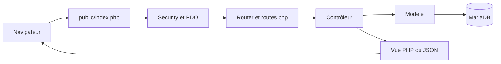
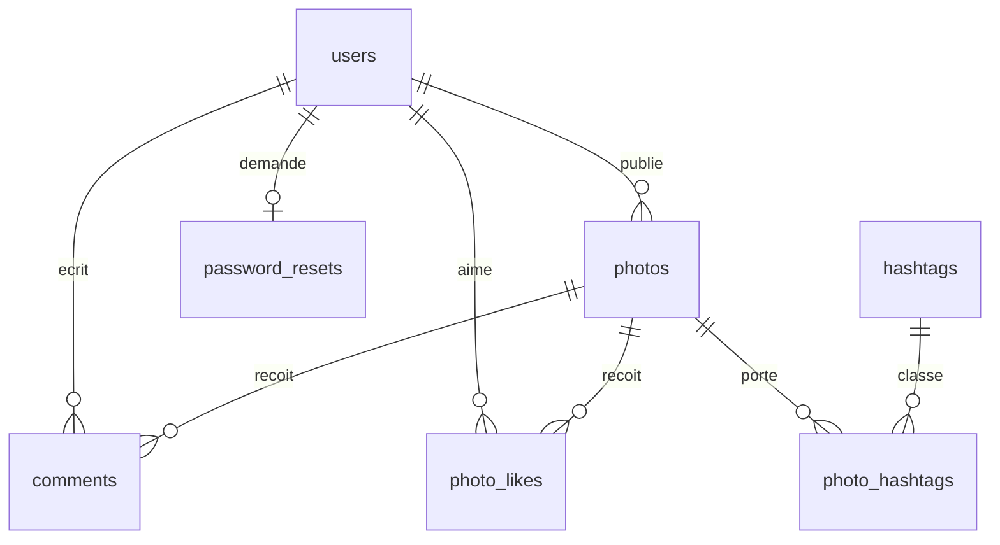

# Architecture de Camagru

Les chemins de cette page sont relatifs à `camagru/`. Le [README](../../README.md) couvre l’installation et les commandes ; la [checklist](validation.md) décrit les vérifications.

## Organisation

| Emplacement | Rôle |
| --- | --- |
| `docker-compose.yml`, `.env.example`, `Makefile` | Services, variables locales et commandes d’exploitation. |
| `docker/php/` | Image PHP 8.2/Apache, extensions GD, PDO MySQL et mbstring, HTTPS local, msmtp et préparation des permissions d’uploads. |
| `src/public/index.php`, `src/public/logout.php` | Entrée HTTP principale et déconnexion POST. Apache expose `src/public/` comme racine. Le fichier `src/.htaccess` contient une règle de réécriture mais se trouve hors de cette racine ; les parcours décrits utilisent `index.php?page=...`. |
| `src/config/routes.php`, `environment.php`, `database.php` | Table de routage, lecture des variables du conteneur et connexion PDO. |
| `src/config/setup.php`, `migrate.php`, `dropdb.php` | Scripts CLI d’initialisation, de migration et de suppression de base. |
| `src/database/` | Schéma `init.sql`, données initiales des stickers et migrations SQL. |
| `src/app/Core/` | `Router`, contrôle de session/CSRF dans `Security` et validation de paramètres dans `Validation`. |
| `src/app/Controllers/`, `Models/`, `Views/` | Actions HTTP, accès aux données et gabarits HTML. |
| `src/app/Services/` | `PhotoComposer` (GD) et `PhotoNotifications` (emails). |
| `src/public/js/`, `css/`, `images/`, `vendor/` | Modules navigateur, styles, filtres PNG et feuilles de style tierces distribuées localement. |
| `src/public/uploads/photos/`, `src/tests/` | Montages créés et vérifications automatisées. |

## MVC et routage

`src/config/routes.php` associe chaque valeur de `?page=` à une méthode de `PageController`, `AuthController` ou `PhotoController`, et indique si elle est publique. `Router::handleRequest()` redirige un visiteur vers la connexion pour une page privée classique, ou renvoie HTTP 403 à la navigation AJAX. Une valeur `page` inconnue affiche l’accueil ; il n’y a pas de page 404 dédiée pour ce cas.

Pour une page classique, `index.php` démarre la session, refuse les méthodes autres que GET et POST, vérifie le jeton CSRF de chaque POST, ouvre PDO puis revalide la session. Le routeur choisit le contrôleur ; s’il renvoie un nom de vue, `Views/layout.php` l’insère entre `header.php` et `footer.php`. Certaines actions, notamment la création de photo et les interactions, renvoient directement du JSON ou une redirection et terminent la requête.

Pour la navigation AJAX, `public/js/router.js` demande `index.php?page=...` avec `X-Requested-With: XMLHttpRequest`. Le serveur renvoie uniquement le fragment de vue ; le navigateur le place dans `#content`, met l’URL à jour et charge le module de page correspondant. Le routeur navigateur refuse de placer une réponse JSON dans cet emplacement HTML. Les actions de galerie, de profil et de studio utilisent `fetch` vers les mêmes routes `?page=...` et reçoivent du JSON ; les POST transmettent le CSRF dans un formulaire ou l’en-tête `X-CSRF-Token`. `public/logout.php` est un point d’entrée séparé, limité au POST avec CSRF.

## Données

`src/database/init.sql` crée les tables InnoDB ; `001_password_resets.sql` et `002_email_notifications.sql` complètent le schéma. `setup.php` applique le schéma, les valeurs initiales et les migrations ; `migrate.php` applique seulement les migrations.

| Table | Colonnes et contraintes principales |
| --- | --- |
| `users` | `id` PK ; `username` et `email` uniques ; hash `password`, `is_verified`, `token` d’activation et `email_notifications` vrai par défaut. |
| `photos` | `photo_id` PK ; `user_id` FK vers `users` avec cascade, `path` du PNG et `created_at`. |
| `stickers` | `sticker_id` PK ; chemin, dimensions positives, hashtag, état actif et dates. Le catalogue du serveur est amorcé par `init.sql`. |
| `photo_likes` | PK composée `(photo_id, user_id)` ; deux FK avec cascade, ce qui interdit un double like d’un même compte. |
| `comments` | `comment_id` PK ; `photo_id` et `user_id` FK avec cascade ; texte `VARCHAR(500)` et dates. |
| `hashtags` | `hashtag_id` PK ; `hashtag` unique. |
| `photo_hashtags` | PK `(photo_id, hashtag_id)` ; deux FK avec cascade. |
| `password_resets` | `user_id` PK/FK avec cascade ; `token_hash` unique, `expires_at` et `requested_at`. |

Les positions de calques ne sont pas conservées après publication : seule l’image finale, son chemin et les associations de hashtags restent en base. Les cascades SQL effacent les lignes liées, pas les fichiers du système de fichiers.

## Studio et galerie

Le navigateur charge les cadres et stickers depuis `src/public/images/filters/filters.json` : deux cadres et neuf stickers actuellement. Les stickers actifs doivent également exister dans la table `stickers` pour être acceptés par le serveur. `Views/studio.php` et `public/js/pages/studio.js` proposent l’aperçu webcam via `getUserMedia` ou l’import PNG/JPEG. L’import peut être recadré par déplacement et zoom ; le navigateur prépare une image carrée. La capture webcam demande un flux exploitable et au moins un cadre ou sticker. L’aperçu des superpositions reste côté navigateur.

`studio.js` transmet à `photo_create` l’image source encodée en PNG/base64, les pourcentages de recadrage, les hashtags et la liste ordonnée `layers`. Chaque calque contient un type (`frame` ou `sticker`), un identifiant et, pour les stickers, la position, la taille et la rotation. Le contrôleur limite la demande à un cadre et dix stickers ; il contrôle les identifiants et les valeurs numériques. `PhotoComposer` décode et vérifie la source PNG/JPEG (10 Mio, 20 millions de pixels au plus), recadre, applique les PNG alpha par GD dans l’ordre transmis et écrit un PNG de 1 024 × 1 024 pixels sous un nom aléatoire dans `public/uploads/photos/{user_id}/`. Les limites `post_max_size` et `upload_max_filesize` de PHP s’appliquent également à la requête.

La création écrit le fichier avant d’insérer `photos` et `photo_hashtags` dans une transaction ; un échec SQL déclenche un nettoyage du fichier. La suppression vérifie le propriétaire en base (`photo_id` et `user_id`) et retire le fichier ; un échec de nettoyage annule la transaction SQL. Les deux supports n’ont toutefois pas de transaction commune en cas d’interruption brutale. Après succès, le studio réinitialise les choix de montage et recharge les photos personnelles via `photo_mine`.

La galerie appelle `photo_public_list` avec `cursor=1&limit=5`, tri `created_at DESC, photo_id DESC`. Le curseur suivant contient `before_created_at` et `before_id`, avec un filtre `hashtag` facultatif. `IntersectionObserver` charge les lots suivants ; un bouton « Charger plus de photos » reste disponible. L’API conserve aussi un mode `limit/offset`. `photo_hashtag_list` fournit les suggestions et `photo_comments` les commentaires publics ; `photo_like_toggle` et `photo_comment_add` sont réservés aux comptes connectés.

## Comptes, emails et contrôles

`AuthController` et `UserModel` gèrent l’inscription, l’activation, la connexion, le profil et les liens de récupération. Les mots de passe sont créés avec `password_hash()` et vérifiés avec `password_verify()`. L’activation utilise un token aléatoire : le GET du lien affiche une confirmation, puis un POST avec CSRF consomme le token. Les tokens de récupération sont stockés sous forme de hash SHA-256, expirent après 30 minutes, sont à usage unique et une nouvelle demande est limitée à une par minute et par compte activé tant qu’un lien récent existe. Un changement de mot de passe invalide les autres sessions lors de leur prochaine requête. Un changement d’email est immédiat après vérification du mot de passe actuel, sans confirmation de la nouvelle adresse.

`Security::startSession()` définit `HttpOnly`, `SameSite=Lax` et `Secure` lorsque la requête est en HTTPS ; `Security::validateSession()` revérifie le compte et la version du mot de passe. Les POST passent par `Security::requireCsrf()` ; le routeur filtre les routes privées, et les contrôleurs vérifient la propriété des ressources. `Validation`, les contrôleurs et `PhotoComposer` valident les entrées côté serveur. Les modèles utilisent PDO avec paramètres liés pour les données fournies par les utilisateurs ; les vues échappent les valeurs et les modules JavaScript insèrent les textes utilisateur comme texte.

Docker Compose transmet `SMTP_USER` et `SMTP_PASS` depuis `.env`. Le démarrage de l’image remplit `docker/php/msmtprc.template` ; `mail()` utilise msmtp vers Gmail. Les emails servent à l’activation, à la récupération et aux notifications de nouveau like ou commentaire. `PhotoNotifications::send()` respecte `users.email_notifications` et ne défait pas une interaction déjà enregistrée si l’envoi échoue. `Security::appUrl()` construit les liens à partir de l’origine directe si elle correspond exactement à `APP_ALLOWED_ORIGINS`, sinon à partir de `APP_URL` ; les en-têtes `Forwarded`, `Origin` et `Referer` ne choisissent pas leur destination.

## Persistance Docker

Le service `db` stocke `/var/lib/mysql` dans le volume Compose `db_data`. Le service `app` monte `./src` sur `/var/www/html` : les photos générées dans `src/public/uploads/photos/` résident donc aussi sur l’hôte. `make down` conserve ces deux stockages. `make resetdb` efface uniquement la base et conserve les fichiers photo, qui peuvent alors devenir orphelins. `make reset` et `make finaldown` appellent d’abord `clean-photos` dans un conteneur ponctuel `app` : tout le contenu de `uploads/photos/`, y compris les sous-dossiers et fichiers cachés, est supprimé sauf le fichier `.gitkeep` à la racine. Un échec arrête la commande avant `docker compose down -v`. `reset` supprime ensuite le volume MariaDB, redémarre les services et réinitialise la base ; `finaldown` supprime les conteneurs, le volume et les images Docker. Les autres uploads et les filtres restent intacts. Le script `uploads-permissions` crée le dossier puis le donne à `www-data` avec répertoires en `755` et fichiers en `644`.

Le service MariaDB n’expose pas de port sur l’hôte. Apache sert HTTP sur `8081` et HTTPS local sur `8443`, avec un certificat autosigné pour `localhost` et `127.0.0.1`. Ce certificat et la configuration SMTP fixe sont destinés à cet environnement ; une exploitation sur un autre nom ou avec un autre fournisseur demanderait une configuration adaptée.
